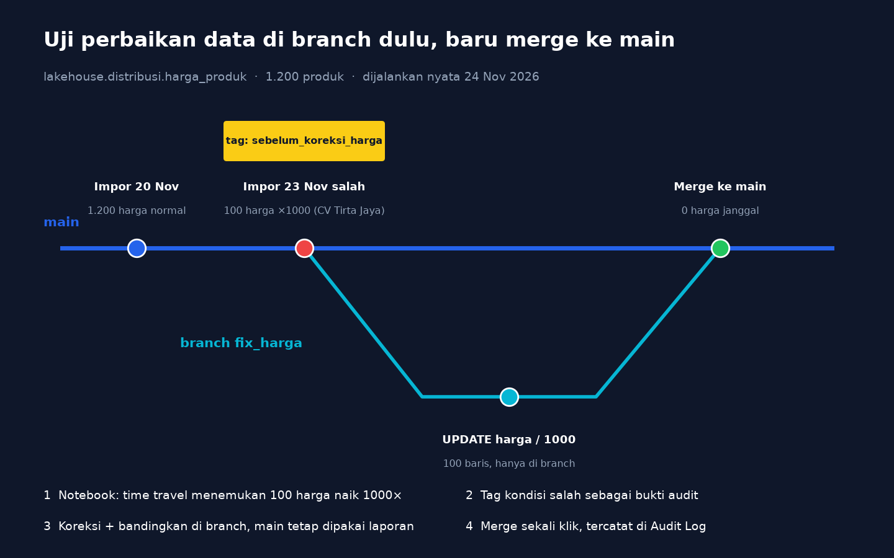
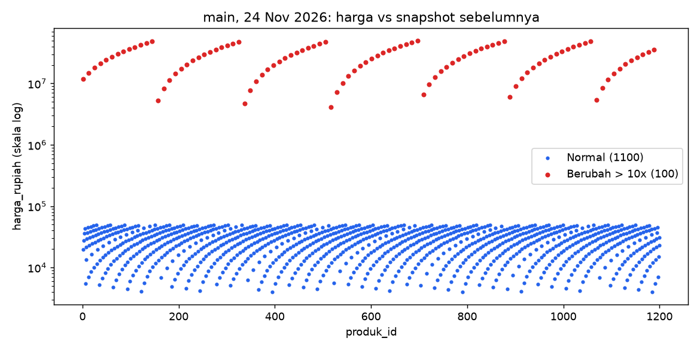
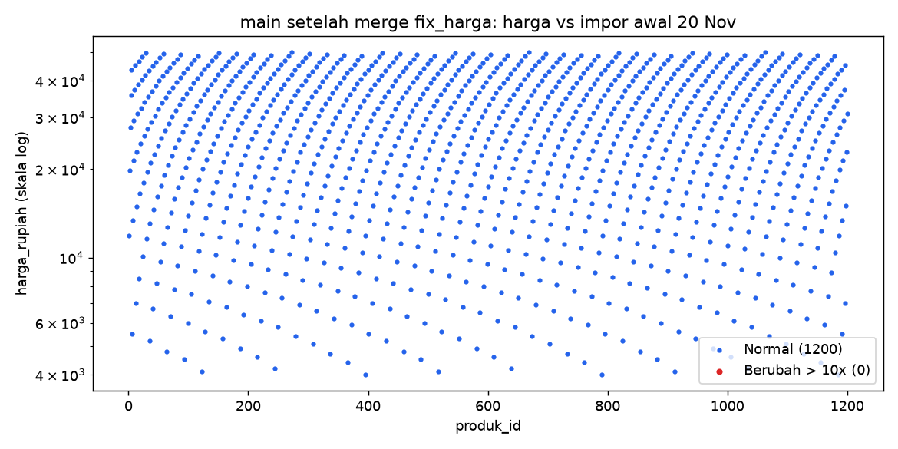

# Walkthrough — Test a Data Fix on a Branch First, Then Merge to Main (Lakehouse + Notebook)

**Language:** [Bahasa Indonesia](README.md) · English

Bad data in a production table is usually fixed with a single `UPDATE` run straight against it,
hoping the `WHERE` clause is right. This walkthrough uses a safer, Git-like workflow for data. A
notebook finds the problem, a tag freezes the bad state, the fix is tested on a branch, and it is
merged into `main` only after it has been proven correct. Every number, SQL statement, and output
below comes from a real run on Enterprise Data Platform (24 November 2026).



## Scenario

A fictional consumer-goods distributor keeps its price list in the Lakehouse:
`lakehouse.distribusi.harga_produk`, 1,200 products from 4 suppliers in 6 categories. Sales
reports and the ordering app read these prices.

| When | What happened |
|---|---|
| 20 Nov | Initial import: 1,200 normal prices (IDR 4,000 to IDR 49,900) |
| 23 Nov | New prices imported from supplier **CV Tirta Jaya**. The file held prices in rupiah, but they were read as "thousands of rupiah", so **100 snack-category prices jumped 1000×**, e.g. IDR 11,900 became IDR 11,900,000 |

In this walkthrough the bad import is simulated with a single `UPDATE` on `main`. As far as the
data is concerned, the result is the same as a faulty import job.

The table and column names are in Indonesian, as in the original run: `harga_rupiah` = price in
IDR, `pemasok` = supplier, `kategori` = category, `berlaku_sejak` = effective date,
`Makanan Ringan` = snacks.

## Step 1 — Notebook: find what changed, using time travel

Open **Notebook** in the sidebar → **Open Notebook**. A connection to the platform's query engine
is already set up, governed by the same access and masking rules as SQL Workspace. Full notebook:
[`notebook/cek-anomali-harga.ipynb`](notebook/cek-anomali-harga.ipynb).

Instead of guessing a "reasonable price" threshold, the notebook compares current prices with the
**previous snapshot of the same table**. Every write to the Lakehouse creates a new snapshot, and
old snapshots stay queryable:

```python
snap = pd.read_sql('SELECT snapshot_id, committed_at, operation '
                   'FROM lakehouse.distribusi."harga_produk$snapshots" ORDER BY committed_at DESC', engine)
prev_id = int(snap.iloc[1]["snapshot_id"])  # snapshot before the latest import
lama = pd.read_sql(f"SELECT produk_id, harga_rupiah AS harga_lama "
                   f"FROM lakehouse.distribusi.harga_produk FOR VERSION AS OF {prev_id}", engine)
df = df.merge(lama, on="produk_id")
df["rasio_perubahan"] = (df["harga_rupiah"] / df["harga_lama"]).round(3)
anomali = df[(df["rasio_perubahan"] > 10) | (df["rasio_perubahan"] < 0.1)]
```

Output:

```
        snapshot_id                     committed_at operation
4257562427355506277 2026-11-24 01:08:40.676000+00:00 overwrite
5109269415934974346 2026-11-24 01:08:29.486000+00:00    append
100 produk berubah harga lebih dari 10x sejak snapshot 5109269415934974346

                                            jumlah  rasio_min  rasio_max
pemasok       kategori       berlaku_sejak
CV Tirta Jaya Makanan Ringan 2026-11-23        100     1000.0     1000.0
```

```
         sku        kategori        pemasok  harga_lama  harga_rupiah  rasio_perubahan
0  SKU-00001  Makanan Ringan  CV Tirta Jaya     11900.0    11900000.0           1000.0
1  SKU-00013  Makanan Ringan  CV Tirta Jaya     14900.0    14900000.0           1000.0
2  SKU-00025  Makanan Ringan  CV Tirta Jaya     18000.0    18000000.0           1000.0
```



The pattern is clear: one supplier, one category, one effective date, all exactly 1000×. This is a
unit error, not a price increase.

> Why not just run `UPDATE` on `main`? Reports and apps read `main` all the time. If the `WHERE`
> clause is slightly off, a second error goes straight into production.

## Step 2 — Tag: freeze the bad state as evidence

**Lakehouse → Tags → New Tag**, name `sebelum_koreksi_harga` ("before price correction"), created
from `main`.

A tag is a pointer that never moves. At any time, auditors or the finance team can see exactly
what data was in use before the correction. The tag is also immediately queryable as the catalog
`lakehouse_sebelum_koreksi_harga`.

## Step 3 — Branch: fix without touching main

**Lakehouse → Branches → New Branch**, name `fix_harga`, created from `main`. The branch is
immediately queryable from **SQL Workspace** as the catalog `lakehouse_fix_harga`.

The fix runs **only** on the branch:

```sql
UPDATE lakehouse_fix_harga.distribusi.harga_produk
SET harga_rupiah = harga_rupiah / 1000
WHERE pemasok = 'CV Tirta Jaya'
  AND berlaku_sejak = DATE '2026-11-23'
  AND harga_rupiah >= 1000000;
-- 100 rows
```

Then compare the branch with `main` in a single query, since both are just two catalogs on the
same query engine:

```sql
SELECT m.kategori,
       count(*)            AS produk_berubah,
       sum(m.harga_rupiah) AS total_harga_main,
       sum(b.harga_rupiah) AS total_harga_fix_harga
FROM lakehouse.distribusi.harga_produk m
JOIN lakehouse_fix_harga.distribusi.harga_produk b ON b.produk_id = m.produk_id
WHERE m.harga_rupiah <> b.harga_rupiah
GROUP BY m.kategori;
```

| kategori | produk_berubah | total_harga_main | total_harga_fix_harga |
|---|---|---|---|
| Makanan Ringan | 100 | 2,656,600,000.00 | 2,656,600.00 |

Only 100 products differ, all in the affected category. No other rows changed. A quick check of
both refs:

| ref | highest price | average |
|---|---|---|
| `main` | 49,500,000.00 | 2,238,537.83 |
| `fix_harga` | 49,900.00 | 26,918.33 |

Throughout this step, `main` did not change at all. Reports and apps kept reading the same data as
before.

## Step 4 — Merge into main

**Lakehouse → Branches → `fix_harga` → Merge into main**. Merge result:

```
was_applied: true
common_ancestor: 6d880fe1…  (the bad 23 Nov import commit)
conflicts: []
```

The merge is recorded in the **Audit Log** (`lakehouse_branch_merged`, source `fix_harga`, target
`main`, plus who ran it). The `fix_harga` branch was then deleted, since its job was done.

If `main` had also changed the same table while the branch was open, the merge would be rejected
and the platform would list the conflicts. Resolve them, then merge again. Nothing is silently
overwritten.

## Step 5 — Verify: main is clean, the old evidence is still there

```sql
SELECT 'main' AS ref, max(harga_rupiah) AS harga_tertinggi,
       count_if(harga_rupiah >= 1000000) AS harga_janggal
FROM lakehouse.distribusi.harga_produk
UNION ALL
SELECT 'tag sebelum_koreksi_harga', max(harga_rupiah), count_if(harga_rupiah >= 1000000)
FROM lakehouse_sebelum_koreksi_harga.distribusi.harga_produk;
```

| ref | highest price | suspicious prices |
|---|---|---|
| `main` | 49,900.00 | 0 |
| tag `sebelum_koreksi_harga` | 49,500,000.00 | 100 |

The same notebook, run again, this time comparing `main` with the initial 20 November import:

```
2342898201932430383 2026-11-24 01:14:55.504000+00:00 overwrite   ← fix_harga merge
4257562427355506277 2026-11-24 01:08:40.676000+00:00 overwrite   ← bad 23 Nov import
5109269415934974346 2026-11-24 01:08:29.486000+00:00    append   ← initial 20 Nov import
0 produk berubah harga lebih dari 10x sejak snapshot 5109269415934974346
```



The full history is kept: the initial import, the bad import, and the fix. All of it can be
queried again with time travel.

---

## Summary

| Step | Feature | Result |
|---|---|---|
| Find the problem | Notebook + time travel (`FOR VERSION AS OF`) | 100 prices up exactly 1000×, one supplier |
| Keep evidence | Tag `sebelum_koreksi_harga` | The bad state can be queried at any time |
| Fix safely | Branch `fix_harga` + SQL Workspace | `main` untouched during the fix |
| Check impact | Cross-branch query | Only 100 rows differ |
| Apply | Merge into main + Audit Log | 0 suspicious prices on `main` |

The same pattern works for other data fixes: backfills, schema migrations, or testing new business
rules. Test on a branch, compare, then merge.

**Free trial, no sales call:** https://alzizan.co.id/register

**Want to see it with your team's own case?** Ask for a demo, or a free in-house *Big Data & AI Tech Update* session at your office: sales@alzizan.co.id
