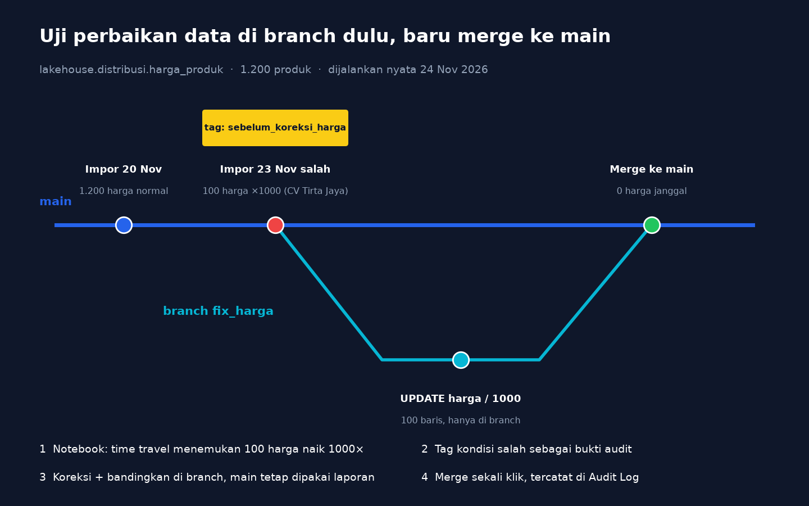
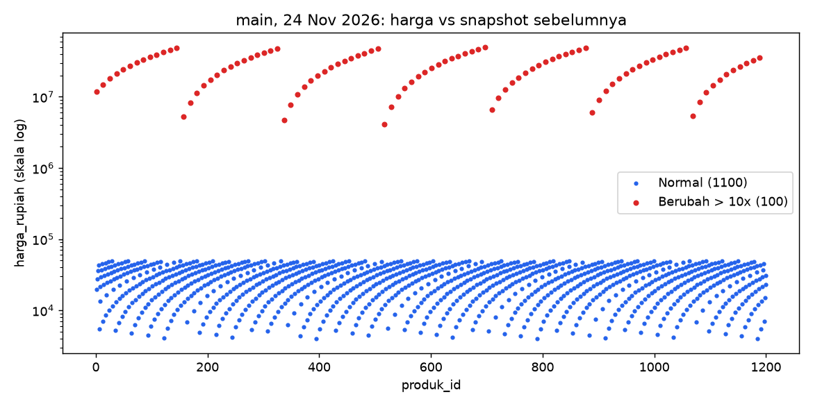
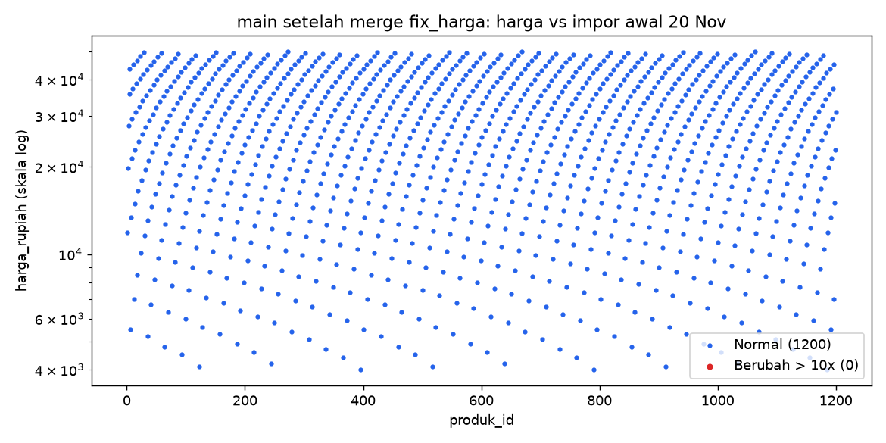

# Walkthrough — Uji Perbaikan Data di Branch Dulu, Baru Merge ke Main (Lakehouse + Notebook)

**Bahasa:** Bahasa Indonesia · [English](README.en.md)

Data yang salah di tabel produksi biasanya diperbaiki dengan satu `UPDATE` langsung, sambil
berharap `WHERE`-nya benar. Walkthrough ini memakai cara yang lebih aman, seperti Git untuk data.
Notebook menemukan masalahnya, kondisi yang salah dibekukan dengan tag, koreksinya diuji di branch,
lalu di-merge ke `main` setelah terbukti benar. Semua angka, SQL, dan output di bawah adalah hasil
run nyata di Enterprise Data Platform (24 November 2026).



## Skenario

Distributor barang konsumsi fiktif menyimpan daftar harga di Lakehouse:
`lakehouse.distribusi.harga_produk`, 1.200 produk dari 4 pemasok dan 6 kategori. Harga ini
dipakai laporan penjualan dan aplikasi pemesanan.

| Waktu | Kejadian |
|---|---|
| 20 Nov | Impor awal: 1.200 harga normal (Rp4.000 s.d. Rp49.900) |
| 23 Nov | Impor harga baru dari pemasok **CV Tirta Jaya**. File berisi harga dalam rupiah, tapi dibaca sebagai "ribuan rupiah". Akibatnya **100 harga kategori Makanan Ringan naik 1000×**, mis. Rp11.900 menjadi Rp11.900.000 |

Di walkthrough ini, impor salah tersebut disimulasikan dengan satu `UPDATE` di `main`. Dari sisi
data, hasilnya sama dengan job impor yang salah.

## Langkah 1 — Notebook: temukan apa yang berubah, pakai time travel

Buka **Notebook** di Sidebar → **Open Notebook**. Koneksi ke query engine platform sudah tersedia,
dan aturan akses serta masking-nya sama dengan SQL Workspace. Notebook lengkap:
[`notebook/cek-anomali-harga.ipynb`](notebook/cek-anomali-harga.ipynb).

Daripada menebak ambang "harga wajar", notebook membandingkan harga sekarang dengan **snapshot
sebelumnya dari tabel yang sama**. Setiap penulisan ke Lakehouse membuat snapshot baru, dan
snapshot lama tetap bisa di-query:

```python
snap = pd.read_sql('SELECT snapshot_id, committed_at, operation '
                   'FROM lakehouse.distribusi."harga_produk$snapshots" ORDER BY committed_at DESC', engine)
prev_id = int(snap.iloc[1]["snapshot_id"])  # snapshot sebelum impor terakhir
lama = pd.read_sql(f"SELECT produk_id, harga_rupiah AS harga_lama "
                   f"FROM lakehouse.distribusi.harga_produk FOR VERSION AS OF {prev_id}", engine)
df = df.merge(lama, on="produk_id")
df["rasio_perubahan"] = (df["harga_rupiah"] / df["harga_lama"]).round(3)
anomali = df[(df["rasio_perubahan"] > 10) | (df["rasio_perubahan"] < 0.1)]
```

Output:

```
        snapshot_id                     committed_at operation
4257562427355506277 2026-11-24 01:08:40.676000+00:00 overwrite
5109269415934974346 2026-11-24 01:08:29.486000+00:00    append
100 produk berubah harga lebih dari 10x sejak snapshot 5109269415934974346

                                            jumlah  rasio_min  rasio_max
pemasok       kategori       berlaku_sejak
CV Tirta Jaya Makanan Ringan 2026-11-23        100     1000.0     1000.0
```

```
         sku        kategori        pemasok  harga_lama  harga_rupiah  rasio_perubahan
0  SKU-00001  Makanan Ringan  CV Tirta Jaya     11900.0    11900000.0           1000.0
1  SKU-00013  Makanan Ringan  CV Tirta Jaya     14900.0    14900000.0           1000.0
2  SKU-00025  Makanan Ringan  CV Tirta Jaya     18000.0    18000000.0           1000.0
```



Polanya jelas: satu pemasok, satu kategori, satu tanggal berlaku, semuanya tepat 1000×. Ini salah
satuan, bukan kenaikan harga.

> Kenapa tidak langsung `UPDATE` di `main`? Laporan dan aplikasi membaca `main` setiap saat. Kalau
> `WHERE`-nya kurang tepat, kesalahan kedua ikut masuk ke produksi.

## Langkah 2 — Tag: bekukan kondisi yang salah sebagai bukti

**Lakehouse → Tag → Tag Baru**, nama `sebelum_koreksi_harga`, dibuat dari `main`.

Tag adalah penanda yang tidak pernah bergerak. Kapan pun, auditor atau tim keuangan bisa melihat
persis data seperti apa yang sempat dipakai sebelum dikoreksi. Tag ini juga langsung bisa di-query
sebagai katalog `lakehouse_sebelum_koreksi_harga`.

## Langkah 3 — Branch: koreksi tanpa menyentuh main

**Lakehouse → Branch → Branch Baru**, nama `fix_harga`, dibuat dari `main`. Branch langsung bisa
di-query dari **SQL Workspace** sebagai katalog `lakehouse_fix_harga`.

Koreksi dijalankan **hanya** di branch:

```sql
UPDATE lakehouse_fix_harga.distribusi.harga_produk
SET harga_rupiah = harga_rupiah / 1000
WHERE pemasok = 'CV Tirta Jaya'
  AND berlaku_sejak = DATE '2026-11-23'
  AND harga_rupiah >= 1000000;
-- 100 baris
```

Lalu bandingkan branch dengan `main` dalam satu query, karena keduanya hanya dua katalog di query
engine yang sama:

```sql
SELECT m.kategori,
       count(*)            AS produk_berubah,
       sum(m.harga_rupiah) AS total_harga_main,
       sum(b.harga_rupiah) AS total_harga_fix_harga
FROM lakehouse.distribusi.harga_produk m
JOIN lakehouse_fix_harga.distribusi.harga_produk b ON b.produk_id = m.produk_id
WHERE m.harga_rupiah <> b.harga_rupiah
GROUP BY m.kategori;
```

| kategori | produk_berubah | total_harga_main | total_harga_fix_harga |
|---|---|---|---|
| Makanan Ringan | 100 | 2.656.600.000,00 | 2.656.600,00 |

Hanya 100 produk yang berbeda, semuanya di kategori yang memang bermasalah. Tidak ada baris lain
yang ikut berubah. Cek ringkas kedua ref:

| ref | harga_tertinggi | rata-rata |
|---|---|---|
| `main` | 49.500.000,00 | 2.238.537,83 |
| `fix_harga` | 49.900,00 | 26.918,33 |

Selama langkah ini, `main` tidak berubah sama sekali. Laporan dan aplikasi tetap membaca data yang
sama seperti sebelumnya.

## Langkah 4 — Merge ke main

**Lakehouse → Branch → `fix_harga` → Merge ke main**. Hasil merge:

```
was_applied: true
common_ancestor: 6d880fe1…  (commit impor salah 23 Nov)
conflicts: []
```

Merge tercatat di **Audit Log** (`lakehouse_branch_merged`, source `fix_harga`, target `main`,
beserta siapa yang menjalankannya). Setelah itu branch `fix_harga` dihapus, karena tugasnya selesai.

Kalau `main` ikut diubah di tabel yang sama selama branch berjalan, merge ditolak dan platform
menampilkan daftar konfliknya. Selesaikan dulu, lalu coba merge lagi. Tidak ada data yang tertimpa
diam-diam.

## Langkah 5 — Verifikasi: main bersih, bukti lama tetap ada

```sql
SELECT 'main' AS ref, max(harga_rupiah) AS harga_tertinggi,
       count_if(harga_rupiah >= 1000000) AS harga_janggal
FROM lakehouse.distribusi.harga_produk
UNION ALL
SELECT 'tag sebelum_koreksi_harga', max(harga_rupiah), count_if(harga_rupiah >= 1000000)
FROM lakehouse_sebelum_koreksi_harga.distribusi.harga_produk;
```

| ref | harga_tertinggi | harga_janggal |
|---|---|---|
| `main` | 49.900,00 | 0 |
| tag `sebelum_koreksi_harga` | 49.500.000,00 | 100 |

Notebook yang sama dijalankan ulang, kali ini membandingkan `main` dengan impor awal 20 November:

```
2342898201932430383 2026-11-24 01:14:55.504000+00:00 overwrite   ← hasil merge fix_harga
4257562427355506277 2026-11-24 01:08:40.676000+00:00 overwrite   ← impor salah 23 Nov
5109269415934974346 2026-11-24 01:08:29.486000+00:00    append   ← impor awal 20 Nov
0 produk berubah harga lebih dari 10x sejak snapshot 5109269415934974346
```



Riwayat lengkapnya tetap tersimpan: impor awal, impor salah, dan koreksinya. Semuanya bisa di-query
ulang lewat time travel.

---

## Ringkasan

| Langkah | Fitur | Hasil |
|---|---|---|
| Temukan masalah | Notebook + time travel (`FOR VERSION AS OF`) | 100 harga naik tepat 1000×, satu pemasok |
| Simpan bukti | Tag `sebelum_koreksi_harga` | Kondisi salah bisa di-query kapan pun |
| Koreksi aman | Branch `fix_harga` + SQL Workspace | `main` tidak tersentuh selama koreksi |
| Cek dampak | Query lintas branch | Hanya 100 baris yang berbeda |
| Terapkan | Merge ke main + Audit Log | 0 harga janggal di `main` |

Pola yang sama berlaku untuk koreksi data lain: backfill, migrasi skema, atau uji aturan bisnis
baru. Uji di branch, bandingkan, lalu merge.

**Coba gratis, tanpa sales call:** https://alzizan.co.id/register

**Mau lihat dengan kasus tim Anda?** Minta demo, atau sesi in-house gratis *Big Data & AI Tech Update* di kantor Anda: sales@alzizan.co.id
